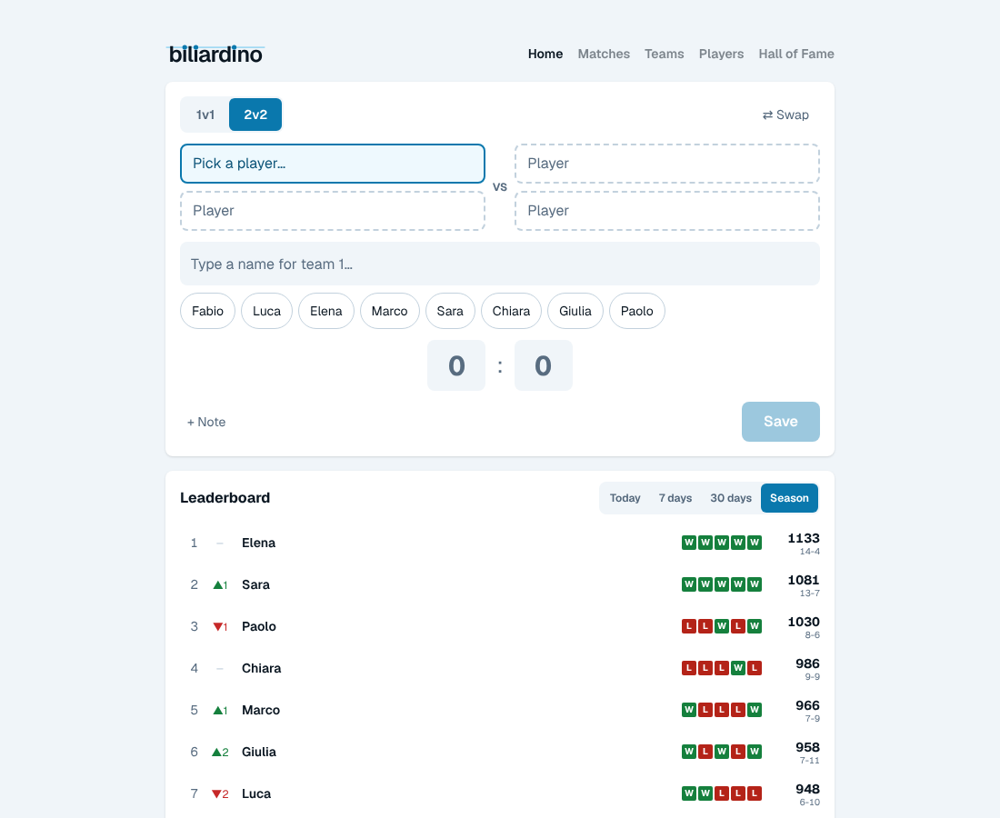

<p align="center">
	<picture>
  	<source media="(prefers-color-scheme: dark)" srcset="public/brand/logo-dark.svg">
  	<source media="(prefers-color-scheme: light)" srcset="public/brand/logo-light.svg">
  	
	</picture>
</p>

A self-hosted tracker for the office foosball table (_biliardino_): 1v1 and 2v2 matches, Elo ratings for players and pairs, leaderboards, a Hall of Fame, achievements and a mobile-first page for entering a result right after the game.

biliardino is based on [Hilde](https://github.com/nehalist/hilde) by [nehalist](https://github.com/nehalist) (MIT licence), modernised and extended; see _Changes from Hilde_ below.

**Guides:** [run it on your computer](docs/LOCAL.md) · [deploy it on a home server](docs/DEPLOY.md) · [how the app is built](docs/ARCHITECTURE.md) · [brand guide](docs/BRAND.md) · [roadmap](docs/ROADMAP.md)



## Features

- Simple, intuitive interface
- **Elo rating** for each team
- **Elo rating for each player** (new), plus per-player statistics, partners and opponents
- **Seasons**: the admin starts a new one with one button; each season shows when it was played (its first and last match) and its match count
- Detailed team statistics (win streaks, win rate, elo history chart, ...)
- **Achievements**, personal (e.g. "Win 100 Matches", "Win 10 Matches in a row") and for pairs (e.g. "Win 50 matches together")
- Compare teams against each other
- Matches are entered by picking **1v1 or 2v2** and the players from a list of defined players
- A team is just a set of players: Elena+Chiara and Chiara+Elena are always the same team, so recurring pairs get their own stats, rating and team achievements, while every player also earns personal achievements in any format
- **Light/Dark theme**
- Match comments
- **Hall of Fame**: all-time records (highest rating, longest win streak, biggest win, biggest upset, ...) and the champion of every season
- Matches page filtered by format, player and season (filters are in the address, so they can be bookmarked)
- Every player name links to that player's profile
- **Help page** for players: every page, the rating, seasons and achievements explained
- Single container, single SQLite file: no database server needed

## Getting Started

Season 1 is created automatically. Then:

1. Open **Players** and add everybody who plays (a player is defined once, with a unique name).
2. On the start page choose **1v1** or **2v2**, type a name (or tap a suggestion) for each side and enter the score. An unknown name can be added as a new player on the spot.

Seasons are managed in the admin UI (`/admin`, password from `ADMIN_PASSWORD`): **Start season N** begins the next one (new matches count there, ratings start at 1000 again); an old season can be made current again or deleted (with its matches, after typing its number).

### Home server (Portainer, Dockge, plain Docker Compose) - recommended

GitHub builds the Docker image whenever you publish a release (a `v…` tag); your server pulls it like any other app. The stack is in [`deploy/compose.yaml`](deploy/compose.yaml) and works with any tool that runs a compose file; the full beginner-friendly walkthrough (GitHub, first release, data folder, Portainer step by step, Dockge and plain Docker alternatives, updates, troubleshooting) in **[docs/DEPLOY.md](docs/DEPLOY.md)**.

### Docker Compose from a checkout

```bash
cp .env.example .env     # then set ADMIN_PASSWORD and NEXTAUTH_SECRET
docker compose up -d --build
```

The app is then available on <http://localhost:3000>; the database lives in the `biliardino-data` volume. Step by step, with every command explained: **[docs/LOCAL.md](docs/LOCAL.md)**. Migrations are applied automatically on every start.

### Manual

Requirements: Node.js 20.9+ (22 recommended).

```bash
cp .env.example .env     # then edit it
npm ci                   # also generates the Prisma client
npm run db:migrate       # creates/updates the SQLite database
npm run build
npm start
```

### Updating, backups and security

- **Updating:** read the top entry of the [changelog](CHANGELOG.md) first (some versions change the database; it says so), then pull the new image or rebuild. Migrations are applied automatically at start. Step by step: [DEPLOY.md](docs/DEPLOY.md#updating-to-a-new-version).
- **Backups:** everything is one SQLite file in the data folder or volume. Take a TrueNAS/ZFS snapshot, or copy the file, before updating. [DEPLOY.md](docs/DEPLOY.md#backups) explains snapshots, copying and restoring.
- **Security:** anybody who can open the page can add and edit matches (on purpose: a result takes seconds to enter); only `/admin` has a password. Run it on your own network, never forward a port to it, and use a VPN for outside access. Options to protect it more are in the [roadmap](docs/ROADMAP.md).
- **Your own copy:** the `ghcr.io/YOUR-GITHUB-USER/biliardino` image in the compose file is built by GitHub from _your_ repository when you publish a release (fork or copy this repository, then follow DEPLOY.md). Without GitHub, `docker compose up -d --build` from a checkout works on any machine with Docker.

## Development

```bash
npm run dev              # dev server on http://localhost:3000 (needs a .env, see above)
npm run db:seed-demo     # fake players and matches for an empty database
npm run check            # lint + formatting, type check, all tests - run before every commit
```

Where things are:

| Path | What |
| --- | --- |
| `src/pages/` | pages (Next.js Pages Router); `index.tsx` is the home page |
| `src/components/Dashboard/` | home page: match entry, leaderboard, pairs, highlight tiles |
| `src/server/routers/` | the API (tRPC procedures), one file per area |
| `src/server/model/` | database logic: saving matches, recalculating a season |
| `src/server/db.ts` | `writeTransaction`: every write that reads first goes through it |
| `src/utils/teamStats.ts` | team ratings and stats (pure functions, tested) |
| `src/utils/playerStats.ts` | per-player ratings and stats (pure functions, tested) |
| `src/utils/dashboard.ts` | home page numbers: period boards, form, highlights (pure, tested) |
| `src/utils/hallOfFame.ts` | Hall of Fame records and season champions (pure, tested) |
| `prisma/` | database schema and migrations |
| `src/**/__tests__/` | unit tests; `src/server/__tests__/` runs the API on a temporary database |
| `e2e/` | browser tests (Chrome/Firefox, see `e2e/README.md`) |
| `docs/` | guides: local run, home-server deployment, architecture, brand, roadmap |
| `design/logo/` | the logo as code; regenerates every logo file and app icon |

Database changes: edit `prisma/schema.prisma`, then `npm run db:migrate:dev -- --name what-changed` creates a migration; it's applied automatically on the next container start.

## Home page

Built for entering a result on a phone right after the game:

1. **Match entry** first: pick 1v1/2v2, type or tap the players (recent players first), type the scores, Save. Players stay selected for rematches; the format is remembered.
2. **Leaderboard** with Today / 7 days / 30 days / Season, last-5 form, rank arrows vs. last week.
3. **Top pairs** (2-player teams with 3+ matches).
4. **Highlights**: hot streak, rising player, biggest upset, most active.
5. **Recent matches**.

Try it with fake data on an empty database: `npm run db:seed-demo`.

## Player statistics

Matches are recorded between _teams_ (`anna,marco` vs `luca,sara`), and the team ratings work as before. In addition, biliardino derives **per-player statistics** from the very same matches, so nothing extra has to be entered:

- `/players`: leaderboard for the current season or all time (rating, matches, W/L, win rate, goal difference, streak)
- `/players/<name>`: rating history, highest/lowest rating, goals, streaks, results per format (1v1, 2v2, ...), results _with_ every partner and _against_ every opponent, best partner / toughest opponent, recent matches

How the player rating works: every player starts at 1000. For each match (replayed in chronological order) a side counts with the **average rating of its players**; the usual Elo formula (same K-factors as the team rating) gives each player of a side the same expected result and the same win/loss outcome, each player's own K-factor applied to their own rating. Because everything is recomputed from the matches, deleting a match simply corrects all player stats. Players with fewer than 5 matches are marked as provisional (`*`).

Players are defined once on the **Players** page (names are unique, case-insensitively). The team of a match is built from the picked players (sorted, lower-cased), so order, spelling or separators can never create a second team.

**Fixing mistakes**

- _Matches_: anyone can edit or delete a match for 24 hours after it was entered (**✎ Edit** on the match). Older matches can only be changed by the admin (link _Admin_ in the footer). Achievements and ratings follow an edit automatically, because they are worked out from the matches.
- _Players_: anyone can rename a player or archive one (hidden from the picker and leaderboards, history is kept). A player without matches can be deleted by anyone; deleting a player _with_ matches also deletes those matches and is admin-only, with a second step where the name must be typed.

## Configuration

| Variable | Description |
| --- | --- |
| `ADMIN_PASSWORD` | Password for `/admin` (min. 8 chars). Required, there is no default. |
| `NEXTAUTH_SECRET` | Random string to sign sessions (min. 16 chars). Required. |
| `NEXTAUTH_URL` | Public URL. Optional in Docker (the address from the browser is used); set it outside Docker, or if a reverse proxy breaks the admin login. |
| `TZ` | Your time zone (e.g. `Europe/Rome`); decides when "Today" starts on the leaderboard. |
| `DATABASE_URL` | SQLite file, `file:/data/biliardino.db` in Docker. Relative paths are relative to `prisma/`. |

## Changes from Hilde

Based on [nehalist/hilde](https://github.com/nehalist/hilde) (last upstream commit: November 2023).

- New identity: celeste palette for light and dark (0.8.0), Geist for all text (0.10.0), the logo with players on a rod (0.11.0), the i's drawn as players (0.15.0).
- Achievements: earned once and kept across seasons, personal for every player and separate ones for pairs, derived from the matches so edits and deletions keep them right (0.15.0).
- Renamed to **biliardino** (0.7.1). A database file from before the rename (`hilde.db`) is renamed automatically on start.

- Dependencies brought up to date (0.10.0): Next.js 16, React 19, tRPC 11, TanStack Query 5, Prisma 7, Tailwind CSS 4, ESLint 10, Jest 30, TypeScript 5.9, Node 22
- **MySQL replaced by SQLite** (Prisma's Rust-free client with the better-sqlite3 driver adapter): one container, one volume. A fresh initial migration replaces the old MySQL ones, **existing MySQL data is not migrated automatically**.
- Secure by default: no built-in admin password or session secret (the app refuses to start without them); deleting old matches or teams and deleting players with matches require the admin login
- New per-player statistics (see above)
- **New match entry**: a separate Players page and a form with a 1v1/2v2 switch and player pickers instead of free-text team names
- A fresh install starts with season 1 active (before, the form was unusable until a season was created in `/admin`)
- Docker image rebuilt (multi-stage, non-root, healthcheck, migrations on start), CI checks every push and publishes releases to GHCR
- Team ratings are recalculated from the remaining matches when a match or team is deleted (before, deleting a lost match lowered the loser's rating further; opponents of deleted teams kept stale ratings)
- Saving is transactional: two phones saving at the same moment can't overwrite each other's ratings
- Fixed a MySQL-only assumption (placeholder `id: 0` on team creation) that breaks on SQLite
- Not changed on purpose: next-auth 4 (now maintained by Better Auth with security fixes; the admin login doesn't need more) and TypeScript 7 (until 7.1 lets ESLint and Jest work with it)

## How this was made

biliardino was built by vastmarks with [Claude](https://claude.ai) (Anthropic), starting from Hilde, as a "vibe-coded" project: vastmarks set the goals and tested the result, and Claude wrote the code, the tests and the documentation. It is checked by an automated test suite and by hand, but it has **not** had an independent code or security review. Read the code and the [security note](#updating-backups-and-security) before you rely on it, and keep it on a private network. The commits record Claude as co-author.

## License

MIT, see [LICENSE](LICENSE). Original work (Hilde) by [nehalist](https://github.com/nehalist); the licence and its copyright notice are kept as the MIT licence requires.
