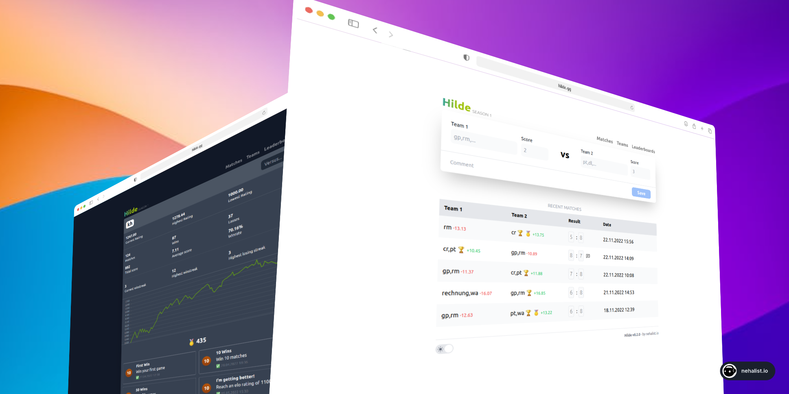

# Hilde 🏆

> A modernised fork of [nehalist/hilde](https://github.com/nehalist/hilde): SQLite, 1v1/2v2 with player pickers,
> per-player stats and a mobile-first home page. **Deploying on a home server: see [docs/DEPLOY.md](docs/DEPLOY.md).**

You've got a foosball table or similar in your office and want to track your matches, player progress and compare yourself to your
colleagues and see who's the best? You've come to the right place.
**Hilde** is a match tracking app for games like foosball, table tennis, air hockey, etc. with achievements, elo ratings, statistics and
more. **Hilde** is easy to setup and can be used by everyone.



## Table of Contents

1. [Features](#features) - Hilde's features
2. [Getting Started](#getting-started) - How to get Hilde up and running
3. [Development](#development) - Working on the code
4. [Player statistics](#player-statistics) - Per-player ratings and stats
5. [Configuration](#configuration) - Environment variables
6. [Changes in this fork](#changes-in-this-fork) - What was modernized
7. [License](#license)

## ⚡️ Features

- Simple, intuitive interface
- **Elo rating** for each team
- **Elo rating for each player** (new), plus per-player statistics, partners and opponents
- **Seasons** (manageable via admin interface)
- Detailed team statistics (win streaks, win rate, elo history chart, ...)
- **Achievements** (e.g. "Win 100 Matches", "Win 10 Matches in a row", ...)
- Compare teams against each other
- Matches are entered by picking **1v1 or 2v2** and the players from a list of defined players
- A team is just a set of players: Elena+Chiara and Chiara+Elena are always the same team, so recurring pairs get their own stats, rating and achievements
- **Light/Dark theme**
- Match comments
- **Leaderboards**
- Single container, single SQLite file: no database server needed

## ⭐ Getting Started

Season 1 is created automatically. Then:

1. Open **Players** and add everybody who plays (a player is defined once, with a unique name).
2. On the start page choose **1v1** or **2v2**, pick the players of both sides from the list and enter the score.

New seasons and deletions are managed in the admin UI (`/admin`, password from `ADMIN_PASSWORD`).

### Home server (Dockge, Portainer, TrueNAS) - recommended

GitHub builds the Docker image whenever you publish a release (a `v…` tag); your server pulls it like any
other app. The stack is in [`dockge/compose.yaml`](dockge/compose.yaml), the full beginner-friendly walkthrough
(GitHub, first release, NAS folder, Dockge, updates, troubleshooting) in **[docs/DEPLOY.md](docs/DEPLOY.md)**.

### Docker Compose from a checkout

```bash
cp .env.example .env     # then set ADMIN_PASSWORD and NEXTAUTH_SECRET
docker compose up -d --build
```

The app is then available on <http://localhost:3000>; the database lives in the `hilde-data` volume.
Migrations are applied automatically on every start.

### Manual

Requirements: Node.js 20.9+ (22 recommended).

```bash
cp .env.example .env     # then edit it
npm ci                   # also generates the Prisma client
npm run db:migrate       # creates/updates the SQLite database
npm run build
npm start
```

## 🧑‍💻 Development

```bash
npm run dev              # dev server on http://localhost:3000 (needs a .env, see above)
npm run db:seed-demo     # fake players and matches for an empty database
npm run check            # lint + formatting, type check, all tests - run before every commit
```

Where things are:

| Path | What |
| --- | --- |
| `src/pages/` | pages (Next.js Pages Router); `index.tsx` is the home page |
| `src/components/Dashboard/` | home page: match entry, leaderboard, pairs, highlight tiles |
| `src/server/routers/` | the API (tRPC procedures), one file per area |
| `src/server/model/` | database logic: saving matches, recalculating a season |
| `src/server/db.ts` | `writeTransaction`: every write that reads first goes through it |
| `src/utils/teamStats.ts` | team ratings and stats (pure functions, tested) |
| `src/utils/playerStats.ts` | per-player ratings and stats (pure functions, tested) |
| `src/utils/dashboard.ts` | home page numbers: period boards, form, highlights (pure, tested) |
| `prisma/` | database schema and migrations |
| `src/**/__tests__/` | unit tests; `src/server/__tests__/` runs the API on a temporary database |
| `e2e/` | browser tests (Chrome/Firefox, see `e2e/README.md`) |

Database changes: edit `prisma/schema.prisma`, then `npm run db:migrate:dev -- --name what-changed` creates a
migration; it's applied automatically on the next container start.

## 🏠 Home page

Built for entering a result on a phone right after the game:

1. **Match entry** first: pick 1v1/2v2, tap the players (recent players first), type the scores, Save. Players stay selected for rematches; the format is remembered.
2. **Leaderboard** with Today / 7 days / 30 days / Season, last-5 form, rank arrows vs. last week.
3. **Top pairs** (2-player teams with 3+ matches).
4. **Highlights**: hot streak, rising player, biggest upset, most active.
5. **Recent matches**.

Try it with fake data on an empty database: `npm run db:seed-demo`.

## 👤 Player statistics

Matches are recorded between _teams_ (`anna,marco` vs `luca,sara`), and the team ratings work as before. In addition,
Hilde now derives **per-player statistics** from the very same matches, so nothing extra has to be entered:

- `/players`: leaderboard for the current season or all time (rating, matches, W/L, win rate, goal difference, streak)
- `/players/<name>`: rating history, highest/lowest rating, goals, streaks, results per format (1v1, 2v2, ...),
  results _with_ every partner and _against_ every opponent, best partner / toughest opponent, recent matches

How the player rating works: every player starts at 1000. For each match (replayed in chronological order) a side
counts with the **average rating of its players**; the usual Elo formula (same K-factors as the team rating) gives each
player of a side the same expected result and the same win/loss outcome, each player's own K-factor applied to their
own rating. Because everything is recomputed from the matches, deleting a match simply corrects all player stats.
Players with fewer than 5 matches are marked as provisional (`*`).

Players are defined once on the **Players** page (names are unique, case-insensitively). The team of a match is built
from the picked players (sorted, lower-cased), so order, spelling or separators can never create a second team.
A player who has no matches yet can be deleted by the admin; renaming players isn't supported.

## 🔧 Configuration

| Variable          | Description                                                                             |
| ----------------- | --------------------------------------------------------------------------------------- |
| `ADMIN_PASSWORD`  | Password for `/admin` (min. 8 chars). Required, there is no default.                    |
| `NEXTAUTH_SECRET` | Random string to sign sessions (min. 16 chars). Required.                               |
| `NEXTAUTH_URL`    | Public URL. Optional in Docker (the address from the browser is used); set it outside Docker, or if a reverse proxy breaks the admin login. |
| `TZ`              | Your time zone (e.g. `Europe/Rome`); decides when "Today" starts on the leaderboard.    |
| `DATABASE_URL`    | SQLite file, `file:/data/hilde.db` in Docker. Relative paths are relative to `prisma/`. |

## 🆕 Changes in this fork

Based on [nehalist/hilde](https://github.com/nehalist/hilde) (last upstream commit: November 2023).

- Dependencies brought up to date: Next.js 15, React 19, tRPC 11, TanStack Query 5, Prisma 6, TypeScript 5.9, Node 22
- **MySQL replaced by SQLite** (Prisma's Rust-free client with the better-sqlite3 driver adapter): one container,
  one volume. A fresh initial migration replaces the old MySQL ones, **existing MySQL data is not migrated automatically**.
- Secure by default: no built-in admin password or session secret (the app refuses to start without them);
  deleting matches/teams/achievements now requires the admin login (it was open to everyone), delete buttons are only shown to admins
- New per-player statistics (see above)
- **New match entry**: a separate Players page and a form with a 1v1/2v2 switch and player pickers instead of free-text team names
- A fresh install starts with season 1 active (before, the form was unusable until a season was created in `/admin`)
- Docker image rebuilt (multi-stage, non-root, healthcheck, migrations on start), CI checks every push and publishes releases to GHCR
- Team ratings are recalculated from the remaining matches when a match, team or achievement is deleted
  (before, deleting a lost match lowered the loser's rating further; opponents of deleted teams kept stale ratings)
- Saving is transactional: two phones saving at the same moment can't overwrite each other's ratings
- Fixed a MySQL-only assumption (placeholder `id: 0` on team creation) that breaks on SQLite
- Not changed on purpose: Tailwind 3, ESLint 8 / `next lint`, next-auth 4 (their successors are bigger migrations)

## License

MIT, see [LICENSE](LICENSE). Original work by [nehalist](https://github.com/nehalist).
