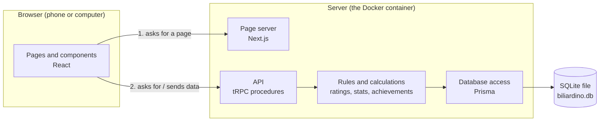
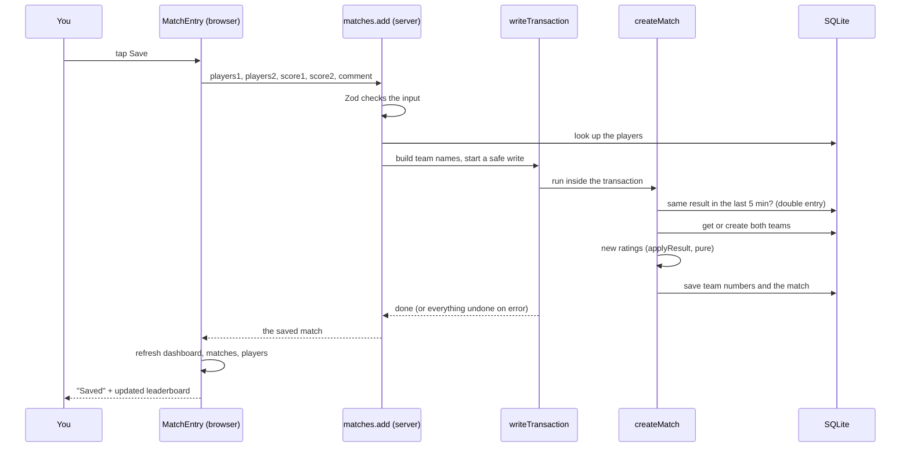
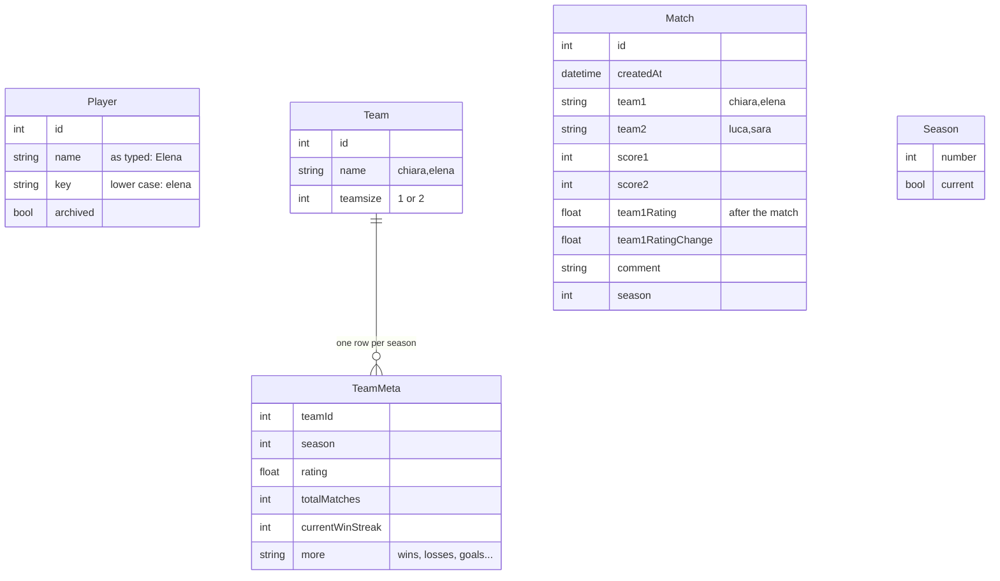

# How biliardino is built

This document explains how the app works inside, for someone who wants to understand and change it without a programming background. Read it from the top the first time: each part builds on the one before. Afterwards it works as a reference: the folder tour (section 3) and the glossary (section 14) are the quickest way back in.

You don't need to read code to follow it, but every section names the files involved, so you can open them next to this text. They are commented for this purpose.

---

## 1. The big picture

biliardino is a **web app**: one program that runs on a server (your NAS, or your Mac in Docker) and sends pages to browsers. It has three parts:



1. **The browser** shows the pages. What you see and click is built with **React** components.
2. **The server** does two jobs: it delivers the pages (via **Next.js**), and it answers data requests from those pages, like "save this match" or "give me the leaderboard" (via **tRPC**).
3. **The database** is a single file, `biliardino.db`, read and written with **SQLite** through **Prisma**.

Everything is written in **TypeScript**, so the same language is used in the browser and on the server. That is what lets tRPC check that both sides agree on every request (see section 5).

**Who can do what.** Nobody logs in to use the app: anyone who can open the page can add players and record matches. That's deliberate for an office table: entering a score must take seconds. There's a single **admin** password for the things that could do damage, such as seasons, changing old matches and deleting players who have played. See section 8.

---

## 2. The technologies, and why each one

| Technology | What it is | Why it's used here | Where |
| --- | --- | --- | --- |
| [TypeScript](https://www.typescriptlang.org/docs/) | JavaScript with _types_: every value declares what it is (a number, a list of players...), and mistakes are caught before the app runs. | Most bugs show up as red underlines instead of as broken pages. | every `.ts` / `.tsx` file |
| [Node.js](https://nodejs.org/en/learn) | The program that runs JavaScript/TypeScript on a server. | Needed to run Next.js. | inside the Docker image |
| [React](https://react.dev/learn) | Builds the user interface out of _components_: small reusable pieces (a button, a match row, the score input) that redraw themselves when their data changes. | The standard for interactive web UIs; huge community. | `src/components/`, `src/pages/` |
| [Next.js](https://nextjs.org/docs/pages) | A framework around React: turns each file in `src/pages/` into a page with its own address, prepares pages on the server, bundles everything for the browser. | One project for pages _and_ API, one container. We use its "Pages Router". | `src/pages/`, `next.config.js` |
| [tRPC](https://trpc.io/docs) | A way for the browser to call functions on the server as if they were local, with types checked on both sides. | No hand-written API documentation to keep in sync; a typo in a field name is a build error. | `src/server/routers/`, `src/utils/trpc.ts` |
| [TanStack Query](https://tanstack.com/query/latest/docs/framework/react/overview) | Keeps data fetched from the server in the browser, refreshes it, and tells components when it changes. Comes with tRPC. | After saving a match, the leaderboard updates by itself. | used through `trpc.….useQuery` |
| [Prisma](https://www.prisma.io/docs/orm) | Describes the database tables in one file and gives typed functions to read and write them. Also manages _migrations_ (changes to the tables). | No hand-written SQL for normal operations; the schema is readable. | `prisma/`, `prisma.config.ts`, `src/server/prisma.ts` |
| [SQLite](https://www.sqlite.org/about.html) | A complete database stored in one file, with no separate database server. | One container, one file to back up. Plenty for an office (thousands of matches a year). | `/data/biliardino.db` |
| [Zod](https://zod.dev) | Describes what valid input looks like ("a score is a whole number 0–99") and rejects everything else. | Every request from a browser is checked before it touches the database. | `src/utils/validation.ts`, `src/server/env.js` |
| [NextAuth](https://next-auth.js.org) | Login handling: password check, the login cookie, the login page. | The admin password. | `src/pages/api/auth/[...nextauth].ts` |
| [Tailwind CSS](https://tailwindcss.com/docs) | Styling through short class names written directly on elements (`rounded-lg p-3 text-sm`). | No separate stylesheets to keep in sync; small final CSS. | `className="..."` everywhere; colours and fonts in `src/styles/globals.css` (`@theme`) |
| [Zustand](https://zustand.docs.pmnd.rs) | A tiny store for state shared between pages in the browser. | Only remembers which season you're looking at. | `src/utils/store.ts` |
| [Jest](https://jestjs.io/docs/getting-started) | Runs automated tests. | About 100 tests run on every change. | `**/__tests__/` |
| [Docker](https://docs.docker.com/get-started/docker-overview/) | Packages the app with everything it needs into an image. | Runs identically on your Mac and the NAS. | `Dockerfile`, compose files |
| [GitHub Actions](https://docs.github.com/en/actions) | GitHub's machines that run the checks and build the image on every push. | Nothing broken reaches the NAS. | `.github/workflows/build.yml` |

---

## 3. A tour of the folders

```text
biliardino/
├── src/                      the application
│   ├── pages/                one file = one page (address = file path)
│   │   ├── index.tsx           home: match entry + dashboard        →  /
│   │   ├── matches.tsx         all matches, filterable              →  /matches
│   │   ├── teams/              teams list and one team              →  /teams, /teams/<name>
│   │   ├── players/            players list and one player          →  /players, /players/<name>
│   │   ├── hall-of-fame.tsx    all-time records, season champions   →  /hall-of-fame
│   │   ├── help.tsx            how the app works, for players       →  /help
│   │   ├── admin/              admin pages (seasons)                →  /admin
│   │   ├── api/                not pages but server endpoints:
│   │   │   ├── trpc/[trpc].ts    the door to the whole API
│   │   │   ├── auth/             the admin login (NextAuth)
│   │   │   └── health.ts         "are you alive?" for Docker
│   │   ├── _app.tsx            wraps every page (layout, theme, API client)
│   │   └── _document.tsx       the HTML shell (icons, app name for phones)
│   ├── components/           React components (pieces of pages)
│   │   ├── Dashboard/          home page: MatchEntry, PlayerSearch, Leaderboard, Pairs, Tiles
│   │   ├── Elements/           shared: MatchTable, MatchEditDialog, PlayerManager, Modal, charts...
│   │   ├── Form/               form fields
│   │   └── Layout/             header, navigation, footer
│   ├── server/               runs only on the server
│   │   ├── routers/            the API, one file per subject (matches, players, teams...)
│   │   ├── model/              database operations that are more than one step
│   │   ├── trpc.ts             who may call what (public / admin)
│   │   ├── db.ts               writeTransaction: safe writes
│   │   ├── prisma.ts           opens the database
│   │   └── env.js              checks the settings at start
│   ├── utils/                calculations and helpers, no database: easy to test
│   │   ├── elo.ts              the Elo formula
│   │   ├── teamStats.ts        team ratings and numbers
│   │   ├── playerStats.ts      player ratings and numbers
│   │   ├── dashboard.ts        home-page numbers (periods, form, highlights)
│   │   ├── achievements.ts     all achievements, and the replay that derives them
│   │   ├── players.ts          player names and team names
│   │   ├── validation.ts       what valid input looks like
│   │   └── editRules.ts        the 24-hour rule
│   ├── model/                small helpers usable in browser and server
│   ├── styles/globals.css    the few global styles, theme colour variables
│   ├── fonts/                Geist, the typeface for all text (bundled)
│   ├── generated/prisma/     the database client, generated from the schema (not in git)
│   └── proxy.ts              sends /admin visitors to the login first
├── prisma/
│   ├── schema.prisma         the database tables
│   └── migrations/           every change to the tables, in order
├── prisma.config.ts          where the database is (read by the Prisma command-line tool)
├── public/                   files served as they are (logo, icons, manifest for "Add to Home Screen")
├── scripts/seed-demo.ts      fills an empty database with fake players and matches
├── e2e/                      browser tests (Chrome, Firefox)
├── docs/                     these guides (BRAND.md: logo, colours, typeface)
├── design/logo/              the logo as code, regenerates all logo files and icons
├── Dockerfile                how to build the image
├── entrypoint.sh             what the container does when it starts
├── docker-compose.yml        run it from this folder (your Mac)
├── deploy/                   run the published image (your server)
├── .github/workflows/        GitHub Actions: checks and image publishing
├── package.json              the project's name, version, scripts and libraries
├── package-lock.json         the exact versions of every library (don't edit by hand)
├── .env.example              template for your settings
└── CHANGELOG.md, README.md, LICENSE
```

Two folders you'll see on your computer but that are never committed: `node_modules/` (the downloaded libraries, recreated by `npm ci`) and `.next/` (the build output).

**One rule organises `src/`:** code that touches the database lives in `src/server/`; pure calculations live in `src/utils/`. A _pure_ function only computes an answer from what it's given ("these matches → this leaderboard"). It doesn't read the database or the clock on its own, so it can be tested quickly and always gives the same answer. Most of the interesting logic is written this way.

---

## 4. Following one action, saving a match

The best way to understand the app is to follow one tap of **Save** from your phone to the database and back.



Step by step, with the files:

1. **The form** (`src/components/Dashboard/MatchEntry.tsx`). It keeps the chosen format, the players in each slot, the scores and the note in React _state_ (values that, when they change, redraw the component). `PlayerSearch.tsx` is the type-ahead box: it filters the roster as you type, ignoring accents and capitals.
2. **The call.** Save runs `trpc.matches.add.useMutation()`. tRPC turns that into an HTTP request to `/api/trpc/matches.add`. Your code just calls a function.
3. **The door** (`src/pages/api/trpc/[trpc].ts`) hands every API request to the main router, `src/server/routers/_app.ts`, which forwards it to `matchesRouter.add` in `src/server/routers/matches.ts`.
4. **Input check.** `matchAddValidation` (in `src/utils/validation.ts`) declares the rules: 1 or 2 players per side matching the format, no player on both sides, scores 0–99, note up to 500 characters. Anything else is rejected with a message before any database work.
5. **Players → teams.** The router loads the players and builds the two team names with `teamNameFromKeys` (`src/utils/players.ts`). See section 6 for why a team is identified by a name.
6. **Safe write.** Everything that _reads then writes_ runs inside `writeTransaction` (`src/server/db.ts`). Two reasons:
   - _All or nothing._ If anything fails halfway, every change is undone; you never get a match without its rating update.
   - _One at a time._ Two phones saving at the same moment are queued, so neither overwrites the other's rating.
7. **The match itself** (`createMatch` in `src/server/model/match.ts`):
   - refuses the exact same result between the same teams within 5 minutes (a double tap);
   - fetches or creates both teams (`getOrCreateTeam`);
   - computes the new numbers for both teams with `applyResult` (`src/utils/teamStats.ts`), a pure function;
   - stores the numbers and the match (including each team's rating change, shown as `+15.5`). Achievements are not granted here: they are derived from the matches (see section 7).
8. **Back in the browser.** On success the form tells TanStack Query that the dashboard, matches and players data are out of date (`invalidate`). Every component showing those refetches and redraws: the leaderboard moves and the match appears in _Recent matches_. The players stay selected for a rematch.

Editing and deleting a match (`matches.update`, `matches.delete` in the same router) follow the same path, with one difference: because every later rating depends on earlier ones, they **recalculate the whole season** afterwards (`rebuildSeason`, see section 7).

---

## 5. How the browser talks to the server

The API is a set of **procedures**: named functions on the server the browser may call. They are grouped by subject in `src/server/routers/`:

| Router | Main procedures |
| --- | --- |
| `matches` | `list`, `infiniteList` (paged, "Load more"; filters: player, format, season or all seasons), `add`, `update`, `delete` |
| `players` | `all`, `names`, `list` (leaderboard, with personal achievement points), `byName` (one player's stats and achievements), `create`, `rename`, `archive`, `delete` |
| `teams` | `list`, `byId` (with the pair's team achievements), `delete` |
| `hallOfFame` | `get`: all-time records and the champion of every season (computed in `src/utils/hallOfFame.ts`) |
| `seasons` | `list`, `start`, `activate`, `renumber`, `delete` |
| `dashboard` | `get`: everything the home page shows, in one request |
| `session` | `isAdmin`: is the admin logged in? |

There are two kinds of procedure:

- a **query** only reads (`trpc.players.all.useQuery()` in a component);
- a **mutation** changes something (`trpc.matches.add.useMutation()`).

Each procedure is defined with one of three starting points from `src/server/trpc.ts`, which decide who may call it:

| Starting point | Who | Used for |
| --- | --- | --- |
| `publicProcedure` | everyone | reading; adding players and matches |
| `roleAwareProcedure` | everyone, but the procedure knows whether the caller is the admin (`ctx.isAdmin`) | rules that differ: editing matches, deleting players |
| `protectedProcedure` | admin only, others get "unauthorized" | managing seasons, deleting teams |

**Why tRPC helps a beginner.** The type of the whole API (`AppRouter`) is exported from `_app.ts` and imported by the browser client (`src/utils/trpc.ts`). If you rename a field on the server, every page using the old name fails the type check (`npm run check`) before anything is deployed. **superjson** is also configured on both sides, so dates arrive in the browser as real dates rather than as text.

---

## 6. The database

### The tables

Defined in `prisma/schema.prisma` (the comments there explain each field):



**Teams are identified by their name, and the name is made from the players.** A team is "the set of players who played together". Its name is the players' keys, sorted alphabetically and joined by a comma: Elena + Chiara and Chiara + Elena are both `chiara,elena`. That gives three useful properties:

- the order in which you pick players can never create a duplicate team;
- a match row shows who played without looking anything up;
- per-player statistics can be computed from the match list alone (split the name at the commas).

The price: renaming a player has to rewrite every team name and match that contains their key. `players.rename` does exactly that, inside one transaction.

**What is stored and what is calculated.**

- _Stored:_ players, teams, matches (with the team ratings at that moment), and `TeamMeta`, the current numbers of each team per season (rating, wins, streaks...). Storing them makes team pages fast.
- _Calculated on demand:_ everything about individual players (rating, form, partners, opponents), the home-page leaderboards and the achievements. They're recomputed from the matches every time. That sounds slow but takes milliseconds for thousands of matches, and it can never go out of sync.

### Migrations, changing the tables safely

A **migration** is a small SQL file that changes the tables, e.g. adding the `archived` column to players: `prisma/migrations/20261107000000_player_archived/migration.sql`. Migrations are applied in date order and each one only once. The database itself records which ones it already has (in a table called `_prisma_migrations`).

That's what makes updates safe: when a new version starts, `entrypoint.sh` runs `prisma migrate deploy`, which applies only the migrations that are new. Your data stays, the tables gain what the new code needs.

To change the tables yourself: edit `schema.prisma`, then run `npm run db:migrate:dev -- --name what-changed`. Prisma compares the schema with the database, writes the new migration file and applies it to your development database. Commit the migration together with the code that uses it.

---

## 7. Ratings and statistics

### Elo, the basic idea

[Elo](https://en.wikipedia.org/wiki/Elo_rating_system) is the rating system from chess. Everyone starts at **1000**. Before a match, the difference between two ratings predicts the result: equal ratings mean 50% each, 200 points more means about 76% for the stronger side. After the match the winner takes points from the loser:

```text
expected = 1 / (1 + 10^((opponent − mine) / 400))
new      = old + K × (result − expected)        result: 1 win, 0.5 draw, 0 loss
```

Beating a stronger side gains a lot; beating a weaker one gains little. **K** decides how fast ratings move: 32 below 1200, 24 up to 1400, 16 above, so newcomers settle quickly and top players are stable. The formula is in `src/utils/elo.ts` (21 lines).

### Team ratings are stored and updated

Each team (each single player in 1v1, each pair in 2v2) has its own rating per season, kept in `TeamMeta`. `applyResult` in `src/utils/teamStats.ts` takes a team's numbers before the match and returns them after: rating, wins, streaks, goals, the "today" numbers. Saving a match calls it for both teams.

**Why editing or deleting recalculates the whole season.** Every rating depends on all the earlier matches. If you fix the score of a match from last Tuesday, every later rating of everyone who played since is slightly different. `rebuildSeason` (`src/server/model/team.ts`) therefore _replays_ the season: it starts all teams at 1000 and applies the remaining matches in date order with `replaySeason`. That's the same `applyResult` used when saving, so the numbers are identical to what they would have been. The tests check that replaying gives the same result as adding the matches one by one.

### Player ratings are always replayed

The per-player rating (`src/utils/playerStats.ts`) is the one on the leaderboard. It isn't stored at all; it's computed by replaying all matches:

- a side's strength is the **average rating of its players**;
- every player of a side gets the same expected result and outcome, but each moves by their **own K-factor**;
- this works for any mix: 1v1 and 2v2 matches count towards the same personal rating.

The same replay produces each player's history, partners ("with") and opponents ("against"), streaks and goals. Players with fewer than 5 matches are marked _provisional_.

`src/utils/dashboard.ts` builds the home page from the same replay: boards for Today, 7 days, 30 days and the season, the last-5 form, rank arrows compared with a week ago, top pairs and the highlight tiles.

### Achievements

Two kinds, both **earned once, ever**: _personal_ achievements belong to a player (any format, any partner; in a 2v2 each player of a side earns them on their own count) and _team_ achievements belong to a pair (matches and wins together, the team rating, streaks as a pair, beating a much stronger pair). A single player has no team achievements.

`src/utils/achievements.ts` lists them (about fifty personal, thirteen for pairs). Each has an id, a title, points, a scope and a _condition_: a small function that looks at a summary of the situation right after a match (career totals, this season's rating and streaks, the day's matches, the ratings before the match, the date) and answers yes or no.

Nothing is stored. `computeAchievements` replays **all matches in order**, like the player statistics, keeps running totals per player and per pair, and records the first match in which each condition became true. `src/server/model/achievements.ts` caches the result until the next write (`dataVersion` in `src/server/db.ts`; a cheap fingerprint of the match table also catches changes from another process). Because it is derived, editing or deleting a match can never leave an achievement behind or lose one, and there is no migration to run when a rule changes.

Milestones (wins, matches, goals) add up all seasons; ratings and streaks are per season, because ratings restart. Personal rating conditions use the individual rating before the match; team ones use the team rating. Points are never stored either: `achievementPoints` adds them up.

---

## 8. Rules and the admin login

**The edit window** (`src/utils/editRules.ts`): anyone may edit or delete a match for **24 hours** after it was entered; afterwards only the admin. The same function decides both whether the browser shows **✎ Edit** and whether the server accepts the change. The server check is what counts: hiding a button is a convenience, not a protection.

**Players** (`src/server/routers/players.ts`): rename and archive are open to everyone. Delete: anyone if the player has no matches; otherwise admin only, and the request must contain the player's name typed again (`confirmName`). The two-step dialog lives in `src/components/Elements/PlayerManager.tsx`.

**The admin login** (`src/pages/api/auth/[...nextauth].ts`):

- one account, no username, the password is `ADMIN_PASSWORD`;
- a wrong password is answered after a 1-second pause, which makes guessing slow;
- the comparison takes the same time however much of a guess is right ("constant time"), so the timing gives nothing away;
- on success NextAuth sets a cookie signed with `NEXTAUTH_SECRET`, valid for 30 days. Because it's signed, it can't be forged without the secret.

`src/proxy.ts` (Next.js used to call this file "middleware") sends anyone opening `/admin` without that cookie to the login page. On the server, `roleAwareProcedure` and `protectedProcedure` read the same cookie.

Because everyone may enter results, keep the app on your home/office network (or behind a VPN such as Tailscale), not open on the internet.

---

## 9. The pages and how they load fast

Most pages load in the browser: the page appears, then fetches its data through tRPC and shows a loading indicator meanwhile.

The **home page** is different, because it's opened right after a match on a phone and should be usable at once. `src/pages/index.tsx` has a `getServerSideProps` function: Next.js runs it **on the server** before sending the page, so the HTML already contains the roster, the leaderboard and the recent matches. In the browser, that data becomes the starting value (`initialData`) of the `dashboard.get` query, so there's no second loading step. After that, TanStack Query refreshes it every time the page comes back into view.

Other choices for speed and phones:

- Small downloads: Next.js splits the code per page, so each page only loads what it uses (`npm run build` prints the sizes; the home page is about 148 kB of JavaScript in total). The rating charts are a small hand-written component instead of a charting library.
- Inputs use a font size of at least 16 px, otherwise iPhones zoom in when you tap them.
- The score fields open the number keyboard; the player search opens the normal one.
- `public/manifest.webmanifest` and the icons let you _Add to Home Screen_; it then opens without browser bars, like an app.
- Light and dark theme follow the phone's setting (`next-themes`), with a toggle in the footer.

---

## 10. Settings and start-up

**Settings** come from environment variables (the `.env` file locally, the stack's environment variables in Portainer or Dockge). `src/server/env.js` checks them with Zod when the app builds and when it starts: a missing or too short `ADMIN_PASSWORD` or `NEXTAUTH_SECRET` stops the app with a clear message instead of running insecurely. There are no default passwords anywhere.

**Start-up** (`entrypoint.sh`, run every time the container starts):

1. check that the password and secret are long enough;
2. check that the data folder is writable, and say how to fix it if not;
3. rename a `hilde.db` from before the rename to `biliardino.db`, once;
4. apply new migrations (`prisma migrate deploy`);
5. start the app (`node server.js`).

`/api/health` answers `{"status":"ok"}` when the app runs and the database responds; Docker calls it every 30 seconds to show _healthy_.

---

## 11. From code to your NAS with Docker and GitHub Actions

### The image (`Dockerfile`)

The image is built in three **stages**. Each starts from a clean Node.js 22 base (the small _Alpine Linux_ variant), and only the last one becomes the image you run:

1. **deps**: installs the exact library versions from `package-lock.json` (`npm ci`), which also generates the database client into `src/generated/prisma`. This stage includes compilers, needed only if the SQLite library has to be built from source.
2. **builder**: copies the code and runs `npm run build`. Next.js produces a _standalone_ output: a minimal `server.js` plus only the library files the app really uses.
3. **runner**: copies just the standalone output, the static files, `public/`, the migrations with `prisma.config.ts` and `entrypoint.sh`, and installs the Prisma command-line tool (to apply migrations) in the exact version the app was built with. Compilers, source code and the full `node_modules` stay behind.

The final image runs as an unprivileged user, never as `root`. On the NAS the compose file sets it to TrueNAS's `apps` user (568), which owns the data folder. The database is outside the image, in the `/data` volume, so replacing the image never touches it.

`.dockerignore` keeps `.env`, `.git`, `node_modules` and local data out of the build, so secrets never end up in an image.

### The robots (`.github/workflows/build.yml`)

On every push to GitHub:

1. **checks**: install, lint and formatting, type check, tests, production build;
2. **docker**: build the image, only if the checks passed.

When the push is a **version tag** (`v0.7.1`), the image is also published to `ghcr.io/<you>/biliardino` as `0.7.1` and `latest`. Dockge's _Update_ pulls `latest`. Nothing reaches the NAS unless every check is green.

---

## 12. Tests and checks

`npm run check` runs everything below except the browser tests, and it's the one command to run before every commit.

| Kind | What it proves | Where |
| --- | --- | --- |
| **Lint** (ESLint) | common mistakes and React rule violations | `eslint .` (rules in `eslint.config.mjs`) |
| **Formatting** (Prettier) | consistent layout of the code, so changes show only what really changed | `prettier --check` |
| **Type check** | every value is used as what it is, API and pages agree | `tsc --noEmit` |
| **Unit tests** | the calculations: Elo, team and player stats, dashboard, achievements, names, 24h rule, search | `src/utils/__tests__/`, `src/components/Dashboard/__tests__/` |
| **API tests** | the real procedures on a temporary database: saving, double entry, editing, deleting and recalculating, rename, archive, permissions, two saves at once | `src/server/__tests__/api.test.ts` |
| **Browser tests** | a real Chrome and Firefox at phone and desktop sizes: entering a match by typing, the note, editing, deleting, renaming, navigation, no layout overflow, no console errors | `e2e/` (run by hand, see `e2e/README.md`) |

A test is a small program that sets up a situation and checks the result, e.g. "after a 10:0 win of A over B, both starting at 1000, A has 1016 and B 984". When a later change breaks that, the test fails and tells you where.

---

## 13. How to make a change, a worked example

Say you want a **"Location"** field on matches (which table was used). The path through the code is always the same:

1. **Database**: in `prisma/schema.prisma`, add `location String @default("")` to `Match`. Run `npm run db:migrate:dev -- --name match-location`; a migration file appears.
2. **Validation**: in `src/utils/validation.ts`, add `location: z.string().max(50).optional()` to `matchAddValidation`.
3. **Server**: in `src/server/routers/matches.ts` (`add`) and `src/server/model/match.ts` (`createMatch`), pass `location` through to `db.match.create`.
4. **Browser**: in `MatchEntry.tsx`, add the input and send `location` with the mutation; in `MatchTable.tsx`, show it.
5. **Test**: in `src/server/__tests__/api.test.ts`, add a case that saves a match with a location and reads it back.
6. **Check**: `npm run check`. The type checker will point at any place you forgot.
7. **Try**: `npm run dev` (needs `npm ci` once and a `.env`), or `docker compose up -d --build`.
8. **Record**: a line in `CHANGELOG.md`, the version in `package.json`, then `git add -A`, `git commit`, `git push`, and a tag for a release ([DEPLOY.md](DEPLOY.md), _Updating to a new version_).

Steps 1 → 4 are the order data flows: table, rules, server, screen. Most changes follow this shape.

---

## 14. Glossary

| Term | Meaning |
| --- | --- |
| **API** | The set of requests the server understands; here, the tRPC procedures. |
| **Build** | Turning the source code into the optimised files that actually run (`npm run build`). |
| **Component** | A reusable piece of interface in React, written as a function that returns what to show. |
| **Cookie** | A small value the browser stores and sends back with every request; carries the admin login. |
| **Environment variable** | A setting given to a program from outside (the `.env` file), not written in the code. |
| **Hook** | A React function starting with `use…` (`useQuery`, `useState`) that gives a component data or state. |
| **Invalidate** | Tell TanStack Query that data is outdated, so it's fetched again. |
| **Library / package / dependency** | Code written by others that the project uses; listed in `package.json`, downloaded into `node_modules`. |
| **Migration** | A file that changes the database tables, applied once, in order. |
| **Mutation / Query** | A request that changes data / one that only reads it. |
| **npm** | Node's package manager: installs libraries (`npm ci`) and runs the project's scripts (`npm run check`). |
| **Procedure** | One function of the tRPC API, e.g. `matches.add`. |
| **Pure function** | Computes an answer only from its inputs, touches nothing else; easy to test. |
| **Replay** | Recomputing ratings by applying all matches again in date order. |
| **Schema** | The description of the database tables (`prisma/schema.prisma`). |
| **Server-side rendering** | Preparing a page's HTML, with data, on the server before sending it (the home page). |
| **State** | Values a component remembers, like the players currently picked; changing them redraws it. |
| **Transaction** | A group of database changes that either all happen or none do. |
| **Type** | What kind of value something is (number, text, a Match...), checked by TypeScript. |

---

## Sources

The official documentation for each technology is linked in section 2. Good places to learn more, in the order they're useful here:

- React, _Learn_ (interactive, starts from zero): <https://react.dev/learn>
- Next.js Pages Router: <https://nextjs.org/docs/pages>
- TypeScript for the new programmer: <https://www.typescriptlang.org/docs/handbook/typescript-from-scratch.html>
- tRPC concepts: <https://trpc.io/docs/concepts>
- Prisma migrations: <https://www.prisma.io/docs/orm/prisma-migrate>
- Elo rating system: <https://en.wikipedia.org/wiki/Elo_rating_system>
- Docker multi-stage builds: <https://docs.docker.com/build/building/multi-stage/>
- Next.js standalone output: <https://nextjs.org/docs/pages/api-reference/config/next-config-js/output>
- Pro Git (free book): <https://git-scm.com/book/en/v2>
