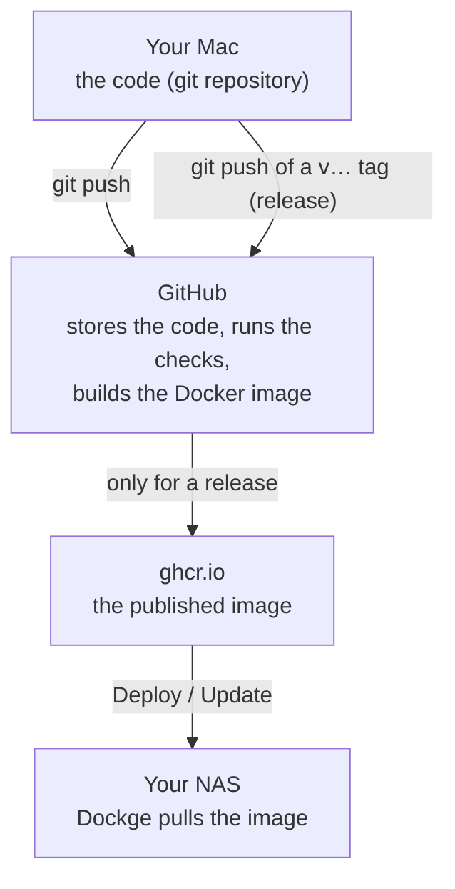

# Deploying Hilde on your home server (TrueNAS + Dockge)

This guide is written for someone who runs self-hosted apps with Docker Compose (Immich,
FileBrowser, …) but has never published their *own* project. It explains every command.
Plan about an hour for the first time; later updates take a few minutes.

## How it fits together



This is the same as the apps you already run: their authors publish images, your Dockge
pulls them. The only difference is that *you* are the author now, and GitHub does the
building for you (free for public repositories).

**Words used below**

| Word | Meaning |
| --- | --- |
| repository (repo) | the project folder including its full history, managed by git |
| commit | a saved snapshot of the code with a message ("what changed and why") |
| push | upload your new commits to GitHub |
| tag / release | a name for one specific commit, like `v0.7.0`; here it means "publish this version" |
| GitHub Actions | GitHub's robots that run the checks and build the image (file `.github/workflows/build.yml`) |
| image | the packaged app that Docker runs; ours is `ghcr.io/<you>/hilde` |

---

## Part 1 - Tools on your Mac (once)

1. **GitHub account.** Sign up at <https://github.com> if you don't have one. Write down your
   username, e.g. `elena89`. Everywhere below, replace `YOUR-GITHUB-USER` with it.
2. **Terminal.** Open the *Terminal* app (Spotlight: `Terminal`). Every command below is typed
   there and confirmed with Enter. Lines starting with `#` are comments, don't type them.
3. **git.** Type:

   ```sh
   git --version
   ```

   If macOS offers to install the "command line developer tools", accept and wait for it to
   finish, then run the command again. You should see something like `git version 2.x`.
4. **Homebrew** (the usual way to install developer tools on a Mac). Check with `brew --version`.
   If it's missing, install it with the one-line command on <https://brew.sh>, then follow the
   "Next steps" it prints at the end.
5. **GitHub CLI** (`gh`, lets the Terminal talk to GitHub):

   ```sh
   brew install gh
   gh auth login
   ```

   Answer: `GitHub.com` → `HTTPS` → `Yes` (authenticate Git) → `Login with a web browser`.
   Copy the one-time code it shows, press Enter, paste the code in the browser, approve.
6. **Tell git who you are** (stored in every commit you make). Use the private address GitHub
   gives you, so your real e-mail isn't published: GitHub → *Settings* → *Emails* → the address
   ending in `@users.noreply.github.com`.

   ```sh
   git config --global user.name "Elena"
   git config --global user.email "12345678+YOUR-GITHUB-USER@users.noreply.github.com"
   ```

## Part 2 - Put the code on GitHub (once)

1. Double-click `hilde-modernized.tar.gz` (from the chat) to unpack it. You get a folder
   `hilde`. Move it somewhere permanent, e.g. a `Code` folder in your home folder, so the path is
   `~/Code/hilde`.
2. Go into the folder and look around:

   ```sh
   cd ~/Code/hilde
   git status       # "On branch main ... nothing to commit, working tree clean"
   git log --oneline | head -5    # the most recent commits (press q if it waits)
   ```

   The history contains the original author's commits (Hilde by Kevin Hirczy, MIT licence) and
   the modernisation commits on top. Keep the `LICENSE` file: the licence requires it.
3. Create the GitHub repository and upload everything in one go:

   ```sh
   gh repo create hilde --public --source=. --remote=origin --push
   ```

   - `--public`: anyone can see the code (there are no secrets in it; your passwords only live
     in Dockge). Public also gives you free, unlimited GitHub Actions minutes.
   - `--remote=origin`: "origin" is git's nickname for your GitHub copy.
   - `--push`: uploads the commits.
4. Open `https://github.com/YOUR-GITHUB-USER/hilde`. You should see the files and the README.
5. Click the **Actions** tab. A run called *Build* has started: it checks the code and builds
   the Docker image as a test. Wait until it shows a green ✓ (about 5-10 minutes; click it to
   watch the steps). If it shows a red ✗, open it, copy the red error text and send it to
   Claude.

## Part 3 - Publish the first release (once, then for every update)

A *release* is what your NAS installs. You publish one by tagging a commit:

```sh
git tag v0.7.0
git push origin v0.7.0
```

GitHub Actions runs again (Actions tab). This time, after the checks, it also uploads the image
to `ghcr.io/YOUR-GITHUB-USER/hilde` with the tags `0.7.0` and `latest`.

**Make the image public (only after the very first release).** New images on GitHub are private
by default, which means your NAS couldn't download it without a password.

1. On GitHub, click your profile picture → **Your profile** → tab **Packages** → **hilde**.
2. **Package settings** (right-hand sidebar) → at the bottom, *Danger Zone* →
   **Change visibility** → **Public** → type `hilde` → **I understand the consequences, change
   package visibility**.

A public package can't be made private again. That's fine here: it only contains the app, never
your data or passwords.

## Part 4 - Prepare the data folder on the NAS (once)

Hilde keeps everything in one database file. Like your FileBrowser setup, it lives in a folder
on your apps dataset and the container runs as TrueNAS's `apps` user (568).

1. TrueNAS web UI → **System** → **Shell** (or SSH into the NAS).
2. Create the folder and give it to the apps user:

   ```sh
   sudo mkdir -p /mnt/apps/docker/data/hilde
   sudo chown 568:568 /mnt/apps/docker/data/hilde
   ls -ln /mnt/apps/docker/data | grep hilde   # should show 568 568
   ```

   (If your apps live somewhere else, use that path here and in the compose file.)

## Part 5 - Create the stack in Dockge (once)

1. On your Mac, create a random secret for the admin login and copy the output:

   ```sh
   openssl rand -base64 32
   ```

2. Dockge → **+ Compose** → stack name `hilde`.
3. In the big compose box, paste the content of `dockge/compose.yaml` from the repository and
   replace `YOUR-GITHUB-USER` (lower case!).
4. In the `.env` box, paste `dockge/.env.example` and fill in:
   - `ADMIN_PASSWORD`: the password for the admin pages (at least 8 characters).
   - `NEXTAUTH_SECRET`: the random string from step 1.
   - `HILDE_PORT`: keep `3000` unless another app already uses it (then e.g. `3010`).
5. **Deploy**. Dockge downloads the image and starts it. In the log you should see:

   ```
   Applying database migrations...
   ...
   Starting Hilde on port 3000...
   ✓ Ready
   ```

## Part 6 - First run

1. Open `http://NAS-IP:3000` (your NAS address, the port from `.env`).
2. **Players** → add everybody who plays.
3. Home page → choose 1v1 or 2v2, tap the players, type the score, **Save**. The match shows up
   under *Recent matches* and the leaderboard updates.
4. On your phone, open the same address and add it to the home screen (Safari: Share →
   *Add to Home Screen*). It then opens like an app.
5. **Admin**: open `http://NAS-IP:3000/admin`, log in with `ADMIN_PASSWORD`. There you manage
   seasons, and (while logged in) delete wrong matches with the ✕ on the Matches page.

Done. 🎉

## Backups

Everything is in `/mnt/apps/docker/data/hilde/hilde.db`. Include that dataset in your TrueNAS
snapshot / replication tasks, or copy the file somewhere else while the stack is stopped.

## Updating to a new version

When the code changes (you or Claude changed something):

```sh
cd ~/Code/hilde
git status                 # which files changed
git diff                   # what exactly changed (q to quit)
git add -A                 # include all changes in the next commit
git commit -m "Short description of the change"
git push                   # upload; GitHub runs the checks (Actions tab)
```

Wait for the green ✓, then publish it as a release with the next version number:

```sh
git tag v0.7.1
git push origin v0.7.1
```

When that Actions run is green, go to Dockge → stack `hilde` → **Update**. It pulls the new
`latest` image and restarts; database changes are applied automatically on start. Your data
stays where it is.

Version numbers follow [semantic versioning](https://semver.org): `v0.7.1` for fixes,
`v0.7.0` for new features.

**Getting changes from Claude.** The easiest way: in a Claude session, attach your GitHub
repository. Claude can then push its changes as a *pull request* (a proposed change). You read it
on GitHub (tab *Pull requests* → *Files changed*), click **Merge**, then `git pull` on your Mac
and tag a release as above.

## Troubleshooting

| What you see | What it means / what to do |
| --- | --- |
| Dockge: `denied` / `unauthorized` when pulling the image | The image is still private (Part 3), or the username in `image:` isn't lower case. |
| Dockge: `manifest unknown` / `not found` | No release published yet, or its Actions run failed (Part 3). |
| Container stops: `The data folder /data is not writable for user 568:568` | Run the `chown` from Part 4 again. |
| Container stops: `ADMIN_PASSWORD must be set...` | Fix the `.env` box in Dockge and deploy again. |
| `port is already allocated` | Another app uses that port: change `HILDE_PORT` in `.env`. |
| The admin login loops back to the login page | Only behind a reverse proxy with its own address: set `NEXTAUTH_URL` in the compose file to exactly that address (see the comment there). |
| Forgot the admin password | Change `ADMIN_PASSWORD` in Dockge's `.env`, deploy again. |
| A red ✗ in GitHub Actions | Open the run, click the red step, copy the error and send it to Claude. Nothing reaches your NAS until it's green. |

## Sources

- GitHub CLI, `gh repo create`: <https://cli.github.com/manual/gh_repo_create>
- Package visibility (new packages are private, how to make one public): <https://docs.github.com/en/packages/learn-github-packages/configuring-a-packages-access-control-and-visibility>
- Pro Git book (free, the standard git introduction): <https://git-scm.com/book/en/v2>
- Why images are built on GitHub instead of in Dockge (Dockge can't rebuild): <https://github.com/louislam/dockge/discussions/267>
