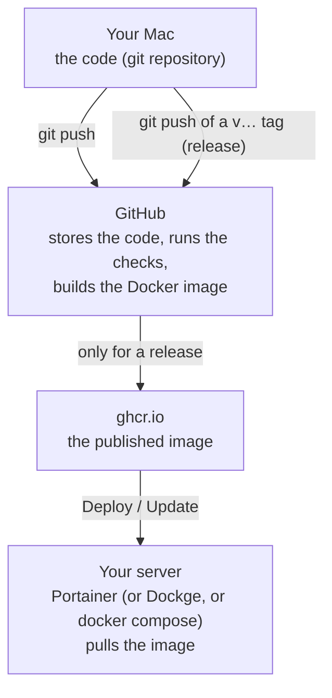

# Deploying biliardino on your home server

This guide is written for someone who runs self-hosted apps with Docker Compose (Immich, FileBrowser, …) but has never published their _own_ project. It explains every command. It works with any tool that can run a compose file: **Portainer** is spelled out step by step, **Dockge** and plain **`docker compose`** are covered too. The data-folder examples use TrueNAS paths; on another system use any folder you like. Plan about an hour for the first time; later updates take a few minutes.

Want to try it on your Mac first? That's [LOCAL.md](LOCAL.md); it also explains Docker itself.

## How it fits together



This is the same as the apps you already run: their authors publish images, your server pulls them. The only difference is that _you_ are the author now, and GitHub does the building for you (free for public repositories).

**Words used below**

| Word | Meaning |
| --- | --- |
| repository (repo) | the project folder including its full history, managed by git |
| commit | a saved snapshot of the code with a message ("what changed and why") |
| push | upload your new commits to GitHub |
| tag / release | a name for one specific commit, like `v0.8.0`; here it means "publish this version" |
| GitHub Actions | GitHub's robots that run the checks and build the image (file `.github/workflows/build.yml`) |
| image | the packaged app that Docker runs; ours is `ghcr.io/<you>/biliardino` |

---

## Part 1 - Tools on your Mac (once)

1. **GitHub account.** Sign up at <https://github.com> if you don't have one. Write down your username, e.g. `elena89`. Everywhere below, replace `YOUR-GITHUB-USER` with it.
2. **Terminal.** Open the _Terminal_ app (Spotlight: `Terminal`). Every command below is typed there and confirmed with Enter. Lines starting with `#` are comments, don't type them.
3. **git.** Type:

   ```sh
   git --version
   ```

   If macOS offers to install the "command line developer tools", accept and wait for it to finish, then run the command again. You should see something like `git version 2.x`.

4. **Homebrew** (the usual way to install developer tools on a Mac). Check with `brew --version`. If it's missing, install it with the one-line command on <https://brew.sh>, then follow the "Next steps" it prints at the end.
5. **GitHub CLI** (`gh`, lets the Terminal talk to GitHub):

   ```sh
   brew install gh
   gh auth login
   ```

   Answer: `GitHub.com` → `HTTPS` → `Yes` (authenticate Git) → `Login with a web browser`. Copy the one-time code it shows, press Enter, paste the code in the browser, approve.

6. **Tell git who you are** (stored in every commit you make). Use the private address GitHub gives you, so your real e-mail isn't published: GitHub → _Settings_ → _Emails_ → the address ending in `@users.noreply.github.com`.

   ```sh
   git config --global user.name "Elena"
   git config --global user.email "12345678+YOUR-GITHUB-USER@users.noreply.github.com"
   ```

## Part 2 - Put the code on GitHub (once)

1. Double-click `biliardino.tar.gz` (from the chat) to unpack it. You get a folder `biliardino`. Move it somewhere permanent, e.g. a `Code` folder in your home folder, so the path is `~/Code/biliardino`. (If you already followed [LOCAL.md](LOCAL.md), it's there already.)
2. Go into the folder and look around:

   ```sh
   cd ~/Code/biliardino
   git status       # "On branch main ... nothing to commit, working tree clean"
   git log --oneline | head -5    # the most recent commits (press q if it waits)
   ```

   The history contains the commits of the original project (Hilde by Kevin Hirczy, MIT licence) and the biliardino commits on top. Keep the `LICENSE` file: the licence requires it.

   Check where the folder points on GitHub:

   ```sh
   git remote -v
   ```

   You should see two lines starting with `upstream`, pointing at `github.com/nehalist/hilde`: the original project. A _remote_ is git's bookmark for a copy of the repository somewhere else; `upstream` is the usual name for the project you forked from. You can only read from it (`git fetch upstream`), never upload to it. Your own copy gets the name `origin` in the next step.

3. Create the GitHub repository and upload everything in one go:

   ```sh
   gh repo create biliardino --public --source=. --remote=origin --push
   ```

   - `--public`: anyone can see the code (there are no secrets in it; your passwords only live in your server's stack settings). Public also gives you free, unlimited GitHub Actions minutes.
   - `--remote=origin`: "origin" is git's nickname for your GitHub copy.
   - `--push`: uploads the commits.

4. Open `https://github.com/YOUR-GITHUB-USER/biliardino`. You should see the files and the README.
5. Click the **Actions** tab. A run called _Build_ has started: it checks the code and builds the Docker image as a test. Wait until it shows a green ✓ (about 5-10 minutes; click it to watch the steps). If it shows a red ✗, open it, copy the red error text and search for it, or ask for help in an issue on the repository.

## Part 3 - Publish the first release (once, then for every update)

A _release_ is what your server installs. You publish one by tagging a commit:

```sh
git tag v0.15.0
git push origin v0.15.0
```

GitHub Actions runs again (Actions tab). This time, after the checks, it also uploads the image to `ghcr.io/YOUR-GITHUB-USER/biliardino` with the tags `0.15.0` and `latest` (use the version number in `package.json` and at the top of the changelog).

**Make the image public (only after the very first release).** New images on GitHub are private by default, which means your server couldn't download it without a password.

1. On GitHub, click your profile picture → **Your profile** → tab **Packages** → **biliardino**.
2. **Package settings** (right-hand sidebar) → at the bottom, _Danger Zone_ → **Change visibility** → **Public** → type `biliardino` → **I understand the consequences, change package visibility**.

A public package can't be made private again. That's fine here: it only contains the app, never your data or passwords.

**Keep it on your network.** Anybody who can open the page can add and edit matches (that is what makes entering a result take seconds); only `/admin` asks for a password. So run it on the home or office network and never forward a port from your router to it. For access from outside, use a VPN (Tailscale or WireGuard). The options for protecting it further are in [ROADMAP.md](ROADMAP.md).

## Part 4 - Prepare the data folder on the server (once)

biliardino keeps everything in one database file. Like your FileBrowser setup, it lives in a folder on your apps dataset and the container runs as TrueNAS's `apps` user (568).

1. TrueNAS web UI → **System** → **Shell** (or SSH into the NAS).
2. Create the folder and give it to the apps user:

   ```sh
   sudo mkdir -p /mnt/apps/docker/data/biliardino
   sudo chown 568:568 /mnt/apps/docker/data/biliardino
   ls -ln /mnt/apps/docker/data | grep biliardino   # should show 568 568
   ```

   (If your apps live somewhere else, use that path here and in the compose file.)

## Part 5 - Create the stack (once)

A _stack_ is a compose file plus its settings, run as one unit. First, on your Mac, create a random secret for the admin login and copy the output:

```sh
openssl rand -base64 32
```

You will enter three settings (the template is [`deploy/.env.example`](../deploy/.env.example)):

- `ADMIN_PASSWORD`: the password for the admin pages (at least 8 characters).
- `NEXTAUTH_SECRET`: the random string from above.
- `BILIARDINO_PORT`: keep `3000` unless another app already uses it (then e.g. `3010`).

Pick the tool you use.

### Portainer

1. Portainer → choose your environment (usually **local**) → **Stacks** → **+ Add stack**.
2. **Name**: `biliardino`. **Build method**: _Web editor_.
3. Paste the content of [`deploy/compose.yaml`](../deploy/compose.yaml) into the editor and replace `YOUR-GITHUB-USER` with your GitHub username (lower case!). If your data folder isn't `/mnt/apps/docker/data/biliardino` (Part 4), change that line too.
4. Scroll to **Environment variables**. Either click **+ Add an environment variable** for each of `ADMIN_PASSWORD`, `NEXTAUTH_SECRET` and `BILIARDINO_PORT`, or click **Load variables from .env file** and pick a copy of `deploy/.env.example` that you edited on your Mac.
5. **Deploy the stack**. Portainer downloads the image and starts it. Open the stack, click the container `biliardino` → **Logs**; you should see:

   ```
   Applying database migrations...
   ...
   Starting biliardino on port 3000...
   ✓ Ready
   ```

### Dockge

1. Dockge → **+ Compose** → stack name `biliardino`.
2. Paste `deploy/compose.yaml` in the compose box (replace `YOUR-GITHUB-USER`, lower case).
3. Paste `deploy/.env.example` in the `.env` box and fill in the three settings.
4. **Deploy**, then check the log as above.

### Plain Docker Compose (any machine with Docker)

```sh
mkdir biliardino && cd biliardino
# put compose.yaml (replace YOUR-GITHUB-USER) and a .env file with the three settings here
docker compose up -d
docker compose logs -f      # Ctrl+C to leave the log; the app keeps running
```

## Part 6 - First run

1. Open `http://SERVER-IP:3000` (your server's address, the port you chose).
2. **Players** → add everybody who plays.
3. Home page → choose 1v1 or 2v2, type each player's name (or tap a suggestion), type the score, **Save**. The match shows up under _Recent matches_ and the leaderboard updates.
4. On your phone, open the same address and add it to the home screen (Safari: Share → _Add to Home Screen_). It then opens like an app.
5. **Admin**: open `http://SERVER-IP:3000/admin`, log in with `ADMIN_PASSWORD`. There you manage seasons, and (while logged in) correct or delete matches older than 24 hours with **✎ Edit**. Newer matches can be fixed by anyone.

Done. 🎉

## Backups

Everything biliardino knows is in one file: `/mnt/apps/docker/data/biliardino/biliardino.db` (the folder from Part 4). Losing it means losing every match, so back it up before you rely on it.

**Recommended: TrueNAS snapshots.** Storage → **Data Protection** → **Periodic Snapshot Tasks** → Add, choose the dataset that holds `/mnt/apps/docker/data` (or a child dataset just for it), daily, keep for 30 days. A snapshot is instant, costs almost no space and is consistent. This is also your safety net against a wrong bulk edit or a vandalised match list.

**By hand.** Stop the stack (so the file isn't being written), copy `biliardino.db` somewhere else (and `biliardino.db-wal` / `-shm` if they exist next to it), start the stack again.

**Restoring.** Stop the stack, put the file back (keep the owner: `sudo chown 568:568 /mnt/apps/docker/data/biliardino/biliardino.db`), start the stack. With snapshots: browse the snapshot folder (`.zfs/snapshot/<name>/`) and copy the file from there.

## Updating to a new version

**Before you update:** read the top entry of [CHANGELOG.md](../CHANGELOG.md) (some versions change the database, and it says what to expect), and make sure you have a recent backup or snapshot (see above). Database changes are applied automatically at start and cannot be undone by running an older version, so the backup is what you go back to.

When the code changes:

```sh
cd ~/Code/biliardino
git status                 # which files changed
git diff                   # what exactly changed (q to quit)
git add -A                 # include all changes in the next commit
git commit -m "Short description of the change"
git push                   # upload; GitHub runs the checks (Actions tab)
```

Wait for the green ✓, then publish it as a release with the next version number (the one in `package.json` and at the top of the changelog):

```sh
git tag v0.15.1
git push origin v0.15.1
```

When that Actions run is green, update the stack:

- **Portainer:** **Stacks** → `biliardino` → **Editor** → switch on **Re-pull image and redeploy** → **Update the stack**. (Without that switch Portainer reuses the image it already has.)
- **Dockge:** stack `biliardino` → **Update**.
- **Plain compose:** `docker compose pull && docker compose up -d`.

The new `latest` image is pulled and the container restarted; database changes are applied automatically on start. In the log, after `Applying database migrations...`, you should see the new migration applied and no error. Your data stays where it is.

Version numbers follow [semantic versioning](https://semver.org): `v0.15.1` for fixes, `v0.16.0` for new features.

**Going back to an older version.** Every release is also published under its own number, so in the compose file you can replace `:latest` with e.g. `:0.15.0` and deploy again. If the newer version had changed the database, also restore the backup taken before the update (see _Restoring_), because an older version can't read a newer database.

**Getting changes through a pull request.** If someone (or an AI assistant with access to your repository) proposes a change, it arrives as a _pull request_. You read it on GitHub (tab _Pull requests_ → _Files changed_), click **Merge**, then `git pull` on your Mac and tag a release as above.

## Troubleshooting

| What you see | What it means / what to do |
| --- | --- |
| `denied` / `unauthorized` when pulling the image | The image is still private (Part 3), or the username in `image:` isn't lower case. |
| Portainer: the stack stays on the old version after an update | **Re-pull image and redeploy** was off: switch it on and update the stack again. |
| `manifest unknown` / `not found` | No release published yet, or its Actions run failed (Part 3). |
| Container stops: `The data folder /data is not writable for user 568:568` | Run the `chown` from Part 4 again. |
| Container stops: `ADMIN_PASSWORD must be set...` | Fix the environment variables of the stack (Portainer: Stacks → biliardino → Editor; Dockge: the `.env` box) and deploy again. |
| `port is already allocated` | Another app uses that port: change `BILIARDINO_PORT` in `.env`. |
| The admin login loops back to the login page | Only behind a reverse proxy with its own address: set `NEXTAUTH_URL` in the compose file to exactly that address (see the comment there). |
| Forgot the admin password | Change `ADMIN_PASSWORD` in the stack's environment variables and redeploy. |
| A red ✗ in GitHub Actions | Open the run, click the red step, copy the error and search for it, or ask in an issue. Nothing reaches your server until it's green. |

## Sources

- GitHub CLI, `gh repo create`: <https://cli.github.com/manual/gh_repo_create>
- Package visibility (new packages are private, how to make one public): <https://docs.github.com/en/packages/learn-github-packages/configuring-a-packages-access-control-and-visibility>
- Pro Git book (free, the standard git introduction): <https://git-scm.com/book/en/v2>
- Portainer, deploying a stack from the web editor and updating it: <https://docs.portainer.io/user/docker/stacks/add>
- Why images are built on GitHub instead of on the server (Dockge can't rebuild): <https://github.com/louislam/dockge/discussions/267>
