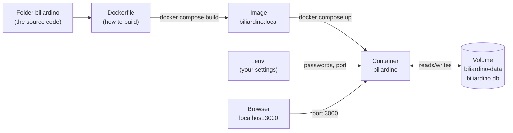

# Running biliardino on your Mac with Docker

This guide gets biliardino running on your own computer, inside Docker, exactly as it will run on the NAS later. It assumes no developer background: every command is explained, and so is every part of it.

Plan about 30 minutes the first time (most of it is waiting for downloads and the first build). After that, starting and stopping takes seconds.

When it works here, [DEPLOY.md](DEPLOY.md) takes the same app to your home server.

---

## Part 0 - Five ideas you need first

You already use Docker through Dockge, so some of this will be familiar. Here it is from the point of view of someone who _builds_ the app instead of only downloading it.

| Idea | What it is | Everyday comparison |
| --- | --- | --- |
| **Image** | A packaged, read-only copy of the app plus everything it needs (Node.js, libraries, the compiled code). Built once from the `Dockerfile`. | An installer, or a frozen meal: everything is inside, ready to heat. |
| **Container** | A running instance of an image. You can stop it, delete it and create a new one from the same image at any time. | The meal on the plate. Throwing it away doesn't lose the recipe. |
| **Volume** | Storage that lives _outside_ the container, so data survives when the container is deleted or replaced. biliardino's database file lives in one. | The fridge: the plate goes, the leftovers stay. |
| **Port mapping** | The app listens on port 3000 _inside_ the container; `3000:3000` connects port 3000 of your Mac to it, so the browser can reach it. | A doorbell on the outside of the house wired to a room inside. |
| **Compose file** | A text file (`docker-compose.yml`) that describes the container: which image, which ports, which volume, which settings. `docker compose` reads it so you don't have to type all that every time. | The recipe card. |

How these fit together for biliardino:



On the NAS the only difference is the first arrow: GitHub builds the image instead of your Mac, and Dockge downloads it.

---

## Part 1 - Install Docker Desktop (once)

You may already have it. If the whale icon is in the menu bar at the top of the screen, skip to Part 2.

1. Go to <https://docs.docker.com/desktop/setup/install/mac-install/> and download the version for your chip: **Apple silicon** for any M1–M5 Mac (Apple menu → _About This Mac_ shows the chip).
2. Open the downloaded `Docker.dmg` and drag Docker into _Applications_.
3. Start Docker from _Applications_. Accept the terms. You can skip signing in ("Continue without signing in"); an account isn't needed for any of this.
4. Wait until the whale icon in the menu bar stops animating. Docker is now running in the background.

Docker Desktop is free for personal use and for small companies (under 250 employees and under 10 million USD revenue). A popular lighter alternative on Mac is [OrbStack](https://orbstack.dev); every command below works the same with it.

**Check it in the Terminal.** Open the _Terminal_ app (Spotlight, `⌘ Space`, type `Terminal`) and type the following, then press Enter:

```sh
docker --version
docker compose version
```

- `docker --version` asks the Docker command-line tool for its version. If you see `Docker version 2x.x.x`, the tool is installed.
- `docker compose version` does the same for _Compose_, the part that reads compose files. You should see `Docker Compose version v2.x.x`.

If you get `command not found`, Docker Desktop isn't running yet: start it and try again.

> **Terminal basics.** You type a command and press Enter. While a command runs, the prompt (the line ending in `%`) disappears; when it comes back, the command is finished. Lines that start with `#` in this guide are comments for you, not commands; you can paste them anyway, the Terminal ignores them. `Ctrl C` stops a command that keeps running.

---

## Part 2 - Get the code into place

1. Download `biliardino.tar.gz` from the chat. Double-click it in _Downloads_: macOS unpacks it into a folder called `biliardino`.
2. Create a home for your code projects and move the folder there. In the Terminal:

   ```sh
   mkdir -p ~/Code
   mv ~/Downloads/biliardino ~/Code/
   cd ~/Code/biliardino
   ```

   - `mkdir -p ~/Code` _makes a directory_ called `Code` in your home folder. `~` is short for your home folder (`/Users/elena`). `-p` means "don't complain if it already exists".
   - `mv A B` _moves_ `A` into `B`. Same as dragging it in Finder.
   - `cd ~/Code/biliardino` _changes directory_: from now on, commands run _inside_ that folder. Most commands below only work when you're in this folder, so if you open a new Terminal window, run this `cd` line first.

3. Have a look around:

   ```sh
   pwd
   ls
   ```

   - `pwd` (_print working directory_) shows where you are: `/Users/<you>/Code/biliardino`.
   - `ls` (_list_) shows what's in the folder. You should see `Dockerfile`, `docker-compose.yml`, `package.json`, `src`, `docs` and others. [ARCHITECTURE.md](ARCHITECTURE.md) explains what each one is.

**If you ran the original Hilde before:** its data lived in a Docker volume called `hilde_hilde-data`. If it was only test data, the cleanest thing is to remove it before you start. See Part 7 below.

---

## Part 3 - Your settings in the .env file

The app refuses to start without an admin password and a secret, on purpose: there are no default passwords anyone could guess. You put them in a file called `.env` ("environment"), which Compose reads automatically.

1. Make your own copy of the example file:

   ```sh
   cp .env.example .env
   ```

   `cp A B` _copies_ file `A` to a new file `B`. `.env.example` is part of the code and stays untouched; `.env` is yours. It's listed in `.gitignore`, so git never uploads it to GitHub, and in `.dockerignore`, so it never ends up inside an image.

   Files starting with a dot are hidden in Finder. Press `⌘ ⇧ .` in Finder to show or hide them.

2. Create a random secret:

   ```sh
   openssl rand -base64 32
   ```

   `openssl` is a cryptography tool that comes with macOS. `rand` asks it for random bytes, `32` of them, and `-base64` turns them into readable characters. You get something like `q3Vt9...=`. Select it and copy it (`⌘ C`). This secret signs the admin login cookie; nobody needs to remember it.

3. Open the settings in TextEdit:

   ```sh
   open -e .env
   ```

   `open` is the same as double-clicking; `-e` means "with TextEdit". (`nano .env` would edit it inside the Terminal instead; save with `Ctrl O`, Enter, and quit with `Ctrl X`.)

4. Change these lines and save (`⌘ S`):

   ```ini
   ADMIN_PASSWORD=your-admin-password
   NEXTAUTH_SECRET=the-random-string-you-copied
   ```

   No quotes are needed around the values, and there are no spaces around `=`.

Leave the rest as it is. What all the lines mean:

| Line | Used by Docker? | Meaning |
| --- | --- | --- |
| `ADMIN_PASSWORD` | yes | Password for the admin pages (min. 8 characters). |
| `NEXTAUTH_SECRET` | yes | The random string (min. 16 characters). |
| `BILIARDINO_PORT` | yes | Port on your Mac. Change it to e.g. `3010` only if 3000 is taken. |
| `TZ` | yes | Time zone: decides when "Today" starts on the leaderboard. |
| `NEXTAUTH_URL`, `DATABASE_URL` | no | Only for running without Docker (`npm run dev`). Docker uses its own values. |

---

## Part 4 - Build and start

```sh
docker compose up -d --build
```

This one line does a lot. Piece by piece:

- `docker compose` reads `docker-compose.yml` in the current folder (that's why you need to be in `~/Code/biliardino`) and the `.env` next to it.
- `up` means "make the containers described in the file exist and run".
- `--build` means "build the image from the code first". Without it, Compose would reuse an image it built earlier and ignore code changes.
- `-d` (_detached_) gives you the Terminal back once everything has started; the app keeps running in the background. Without it, the app's log scrolls by and `Ctrl C` stops the app.

**What you'll see.** The first build takes 3 to 10 minutes, because Docker downloads Node.js and all the libraries. The steps follow the `Dockerfile`:

1. `deps`: installs the libraries listed in `package-lock.json` (`npm ci`).
2. `builder`: compiles the app (`npm run build`). The settings checks run here with throwaway values.
3. `runner`: builds a small final image with only what's needed to _run_: the compiled app, the database migrations, the start script. The build tools from steps 1 and 2 are left out, which keeps the image small and safer.

Docker remembers each step. If you change only some code, the next build skips the library download and takes about a minute.

At the end you'll see `Container biliardino-biliardino-1  Started`. The name is _project-service-number_: the project name comes from the folder (`biliardino`), the service name from the compose file (`biliardino`), and `1` is the first copy.

---

## Part 5 - Check it's running, then use it

```sh
docker compose ps
```

`ps` (_process status_) lists this project's containers. Look at the `STATUS` column:

- `Up 10 seconds (health: starting)`: it's starting. The image has a _health check_: every 30 seconds Docker asks the app `/api/health`, which checks that the database answers.
- `Up 1 minute (healthy)`: ready.
- Nothing listed, or `Exited`: it stopped. The next command tells you why.

```sh
docker compose logs
```

`logs` shows what the app printed. A good start looks like this:

```text
Applying database migrations...
3 migrations found in prisma/migrations
...
All migrations have been successfully applied.
Starting biliardino on port 3000...
 ✓ Ready in 300ms
```

On later starts the middle part says `No pending migrations to apply.`

The start script (`entrypoint.sh`) first checks your settings, then brings the database up to date (_migrations_, see section 6 of [ARCHITECTURE.md](ARCHITECTURE.md)), then starts the app. `docker compose logs -f` (_follow_) keeps showing new lines as they come; `Ctrl C` stops watching, not the app.

**Open it:** <http://localhost:3000>. `localhost` means "this computer".

1. **Players** → add a few names.
2. **Home** → 1v1 or 2v2, type a name in the search box and press Enter (or tap a suggestion), do the same for each slot, type the scores, **Save**.
3. **Admin** (link in the footer) → log in with your `ADMIN_PASSWORD`. Here you manage seasons and can edit matches older than 24 hours.

**Try it on your phone.** Phone and Mac on the same Wi-Fi. Find your Mac's address:

```sh
ipconfig getifaddr en0
```

`ipconfig getifaddr` prints the address of a network interface; `en0` is the Wi-Fi on most Macs. You get something like `192.168.1.23`. On the phone, open `http://192.168.1.23:3000`. If macOS asks whether to allow incoming connections for Docker, click _Allow_.

---

## Part 6 - Everyday commands

All of them run inside `~/Code/biliardino`.

| Command | What it does | Your data |
| --- | --- | --- |
| `docker compose stop` | Pauses the container. | kept |
| `docker compose start` | Resumes it. | kept |
| `docker compose restart` | Stop and start in one go. Doesn't pick up `.env` changes, see the note below. | kept |
| `docker compose down` | Removes the container (and the private network Compose created for it). The image and the volume stay. | **kept** |
| `docker compose up -d` | Creates and starts the container again from the existing image. | kept |
| `docker compose up -d --build` | Rebuilds the image from the code, then replaces the container. Use it after any code change. | kept |
| `docker compose logs -f` | Shows the app's output live. | - |
| `docker compose down -v` | Removes the container **and the volume** (`-v` = volumes). | **deleted** |

> **Changing `.env`.** Settings are given to the container when it's _created_, so after editing `.env` use `docker compose up -d` (it notices the change and recreates the container). `restart` would keep the old values.

Docker Desktop also shows all of this in its window: _Containers_ (with logs and a stop button), _Images_ and _Volumes_. It's a good way to see what the commands did.

**Back up the database** while the app runs. SQLite keeps recent changes in a side file, so the safe way is to ask SQLite itself for a copy:

```sh
docker compose exec biliardino node -e "new (require('better-sqlite3'))('/data/biliardino.db').backup('/data/backup.db').then(() => console.log('ok'))"
docker compose cp biliardino:/data/backup.db ./backup.db
```

- `docker compose exec biliardino <command>` runs a command _inside_ the running container `biliardino`. Here it's a one-line Node.js program (`node -e "..."`) that uses the SQLite library the app already has to write a consistent copy, `backup.db`, into the volume.
- `docker compose cp <container>:<path> <here>` copies a file out of the container to your Mac: `./backup.db` means "into the current folder".

The `.gitignore` doesn't cover `backup.db`, so move it out of the project folder (e.g. to `~/Documents`) to make sure it never gets committed.

---

## Part 7 - Removing a test installation

To remove everything a copy of the project created (containers, data volume and image), for example the original Hilde or a test you no longer need:

```sh
cd ~/path/to/the/folder     # the folder you started it from
docker compose down -v --rmi all
```

- `down -v` removes the container and its volume (the data; for the original Hilde it is called `hilde_hilde-data`).
- `--rmi all` (_remove images_) also deletes the image built on your Mac, freeing about half a gigabyte.

Then delete the folder in Finder. If you no longer have the folder, open Docker Desktop → _Containers_, _Volumes_ and _Images_ and delete the ones with that project's name from there.

A database file from before the rename (`hilde.db`) is renamed to `biliardino.db` on first start. The volume has a different name than Hilde's, though, so old data would have to be copied across first.

---

## Part 8 - Updating your copy

If you cloned the repository with git:

```sh
cd ~/Code/biliardino
git pull
docker compose up -d --build
```

If you got a new archive instead (a `.tar.gz` of the project):

```sh
cd ~/Code
mv biliardino biliardino-old
# unpack the new biliardino.tar.gz from Downloads (double-click), then:
mv ~/Downloads/biliardino ~/Code/
cp biliardino-old/.env biliardino/
cd biliardino
docker compose up -d --build
```

- The first `mv` renames the old folder, so you can go back if something's wrong.
- `cp` copies your settings into the new folder (the archive never contains a `.env`).
- `up -d --build` builds the new code and replaces the container. Because the folder is still called `biliardino`, Compose finds the same volume: your matches are still there. Database changes are applied automatically by the start script.

Before updating, read the top entry of [CHANGELOG.md](../CHANGELOG.md): some versions change the database. To back up a local installation first: `docker compose cp biliardino:/data/biliardino.db ./biliardino-backup.db` (run it from the project folder while the container is running).

When the new version works, delete `biliardino-old`.

---

## Troubleshooting

| What you see | What it means / what to do |
| --- | --- |
| `Cannot connect to the Docker daemon` | Docker Desktop isn't running. Start it and wait for the whale to stop moving. |
| `no configuration file provided: not found` | You're not in the project folder. Run `cd ~/Code/biliardino`. |
| `required variable ADMIN_PASSWORD is missing a value` | There's no `.env` file, or that line is empty (Part 3). |
| `ERROR: ADMIN_PASSWORD must be set and at least 8 characters long.` in the logs | The password is too short. Fix `.env`, then `docker compose up -d`. |
| `Bind for 0.0.0.0:3000 failed: port is already allocated` | Another program uses port 3000. Set `BILIARDINO_PORT=3010` in `.env`, `docker compose up -d`, open <http://localhost:3010>. |
| The browser says it can't connect | Wait for `(healthy)` in `docker compose ps`; check `docker compose logs`. |
| The build fails | Copy the last 30 lines of the output and search for them, or ask in an issue on the repository. Common cause: no internet during the first build. |
| Disk filling up | Docker Desktop → _Images_, or `docker system df` to see what uses space and `docker image prune` to remove images nothing uses. |

## Sources

- Install Docker Desktop on Mac: <https://docs.docker.com/desktop/setup/install/mac-install/>
- Docker concepts (images, containers): <https://docs.docker.com/get-started/docker-overview/>
- Docker Compose overview: <https://docs.docker.com/compose/>
- `docker compose` command reference (`up`, `down`, `logs`, `exec`, `cp`, ...): <https://docs.docker.com/reference/cli/docker/compose/>
- Volumes: <https://docs.docker.com/engine/storage/volumes/>
- SQLite online backup (what the backup command uses): <https://www.sqlite.org/backup.html>
